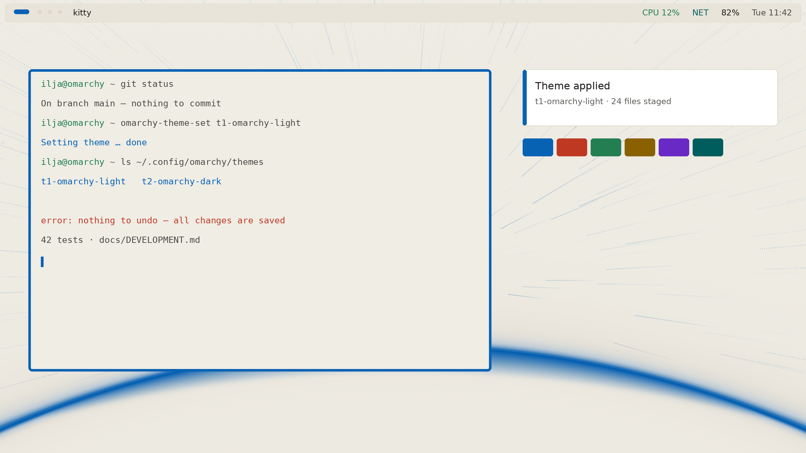

# T1 Omarchy Light

A light theme for Omarchy, built on the T1 palette.

- **What it is:** a light theme for Omarchy, the Arch Linux desktop.
- **What it does:** paints the shell, the bar, the launcher, the notifications and the terminals in warm off-white with a steel-blue accent. Without it the screen stays dark and hard to read in daylight.
- **What it needs:** Omarchy on Arch Linux. Nothing else.
- **How to start:** run `omarchy-theme-install https://github.com/iliFalk/T1-omarchy-light.git`. It clones the theme and applies it at once.

Inspired by the original [Oxocarbon Dark theme](https://github.com/HANCORE-linux/omarchy-oxocarbon-theme) by HANCORE.

## Install

1. Run `omarchy-theme-install https://github.com/iliFalk/T1-omarchy-light.git`. Omarchy clones the theme, names it `t1-omarchy-light` and applies it.
2. To apply it again later, run `omarchy-theme-set t1-omarchy-light`.

Omarchy takes the name from the repository address: it drops a leading `omarchy-` and a trailing `-theme`, then makes the name lower case. Neither applies here.

To keep a frozen copy instead, download the archive, unpack it into `~/.config/omarchy/themes/t1-omarchy-light`, then run `omarchy-theme-set t1-omarchy-light`.

## Use

| Where | What it does |
|---|---|
| Theme menu | `t1-omarchy-light` applies the palette to the shell, the bar, the launcher and the notifications. |
| Terminal | Alacritty, Ghostty, Kitty and Foot take the T1 colors on the warm ground. |
| Backgrounds | `backgrounds/` holds one wallpaper: the light horizon. |
| Theme switch | `backgrounds/intros/1-horisont.mp4` plays a six-second flight into the wallpaper, then the still takes over. `omarchy theme bg intro disable` turns it off. |

## Settings

| File | Holds |
|---|---|
| `colors.toml` | The palette. Every other file derives from it. |
| `backgrounds/` | The wallpaper and its intro clip. |
| `custom_theme.json` | The same palette in the theme editor's format. |
| `waybar.css`, `mako.ini`, `walker.css`, `swayosd.css` | The bar, the notifications, the launcher and the volume overlay. |
| `preview.png` | A composition of these surfaces on the shipped wallpaper, not a screen capture. |

## Docs

- `docs/DEVELOPMENT.md` — the palette table, the terminal slots, the themed surfaces, the backgrounds and the credits.
- `LICENSE` — MIT.
